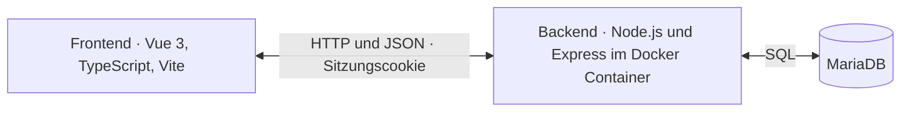
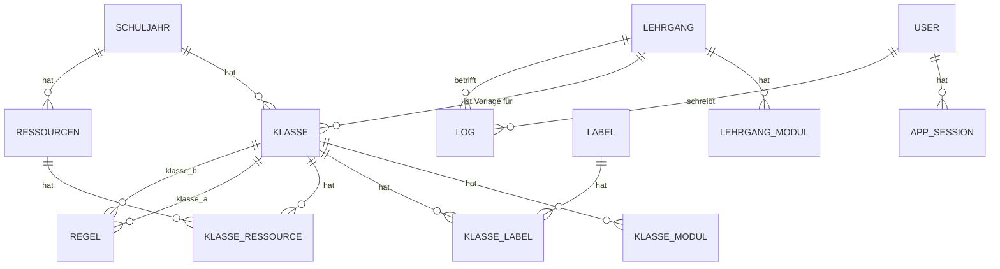

# Lehrway Backend: Datenbank und API für die gemeinsame Schulplanung

IPT 8.1 · Node.js · Express · MariaDB · Docker

Lehrway ist eine Webanwendung für die gemeinsame Schulplanung. Dieses Repository enthält das Backend: die MariaDB Datenbank mit Struktur und Testdaten sowie die Express API, die das Lehrway Frontend mit Daten versorgt. Das Backend speichert Lehrgänge, Module, Klassen, Labels, Regeln und Raumkapazitäten, verwaltet Benutzerkonten mit Sitzungen und protokolliert Änderungen für den Änderungsverlauf.

Das Frontend liegt in einem eigenen Repository. Dort sind die Wochenansicht, die Lehrgangsplanung und der Änderungsverlauf umgesetzt.

## Nutzen und Ziele

- **Eine gemeinsame Datenbank für das ganze Team.** Alle arbeiten über das Backend auf denselben Daten, damit alle dieselbe Planung sehen.
- **Lehrgänge als Vorlage für Klassen.** Ein Lehrgang enthält die Module mit Lehrjahr, Quartal und Lektionen. Jede Klasse besitzt eigene Module, die bei der Erstellung aus dem Lehrgang kopiert werden und danach unabhängig angepasst werden können.
- **Planungsregeln und Raumkapazitäten speichern.** Regeln zwischen Klassen und die Anzahl Räume pro Wochentag liegen in der Datenbank. So kann das Frontend Konflikte anzeigen.
- **Änderungen nachvollziehen.** Das Protokoll speichert Benutzer, Aktion und betroffenes Objekt sowie den Zustand vorher und nachher als JSON.
- **Sichere Anmeldung.** Passwörter werden nur als Hash gespeichert. Sitzungen laufen nach 8 Stunden ab.

## Funktionen

| Bereich | Was das Backend übernimmt |
|---|---|
| Benutzerkonto | Registrierung mit Anzeigename, E-Mail und Passwort, Anmeldung und Sitzung über ein Cookie |
| Lehrgänge und Module | Lehrgänge anlegen, umbenennen und löschen, Module mit Lehrjahr, Semester, Quartal, Quartalsspanne und Lektionen verwalten |
| Klassen | Klassen pro Schuljahr mit Lehrgang, Notizen und Anzahl Schultage pro Woche speichern, eigene Klassenmodule führen |
| Wochenplan | Anzahl Räume pro Wochentag und Schuljahr speichern, Klassen den Wochentagen zuordnen |
| Regeln und Labels | Klassenpaare festhalten, die nicht am selben Tag Unterricht haben sollen, und farbige Labels mit Klassen verknüpfen |
| Änderungsverlauf | Aktionen mit Benutzer, Zeitpunkt und Vorher Nachher Zustand im Protokoll ablegen |

## Architektur



Dieses Repository enthält das Backend und die Datenbank. Das Frontend befindet sich im Lehrway Frontend Repository.

## Datenbank

Die Datenbank heisst `lehrway` und enthält dreizehn Tabellen.

| Tabelle | Aufgabe |
|---|---|
| `schuljahr` | Schuljahre wie 2026/27, an denen Klassen und Raumkapazitäten hängen |
| `lehrgang` | Lehrgänge mit Bezeichnung und Semesteranzahl |
| `lehrgang_modul` | Module eines Lehrgangs mit Lehrjahr, Semester, Quartal, Quartalsspanne und Lektionen |
| `klasse` | Klassen mit Lehrgang, Schuljahr, Notizen und Schultagen pro Woche |
| `klasse_modul` | Eigene Kopie der Module einer Klasse, unabhängig vom Lehrgang änderbar |
| `label` | Labels mit Name und Farbe |
| `klasse_label` | Verknüpfung von Klassen und Labels mit Farbe |
| `regel` | Klassenpaare, die nicht am selben Tag Unterricht haben sollen |
| `ressourcen` | Anzahl verfügbarer Räume pro Wochentag und Schuljahr |
| `klasse_ressource` | Zuordnung von Klassen zu den Wochentagen |
| `user` | Benutzername, E-Mail, Passworthash und letzte Aktivität |
| `app_session` | Angemeldete Sitzungen mit gehashtem Token und Ablaufzeit |
| `log` | Protokoll mit Lehrgang, Benutzer, Aktion, Objekt sowie Zustand vorher und nachher |

### Beziehungen



Die Beziehungen sind durch Fremdschlüssel abgesichert. Eindeutig sind der Klassenname pro Schuljahr, der Labelname, der Benutzername und die E-Mail. Eine Regel verweist immer auf zwei verschiedene Klassen, und jedes Klassenpaar kann nur einmal vorkommen.

## API

Die API ist unter `http://localhost:3000/api` erreichbar und tauscht JSON aus. Die Anmeldung läuft über ein Sitzungscookie. Auszug der Routen:

| Methode | Pfad | Aufgabe |
|---|---|---|
| POST | `/api/register` | Konto mit Anzeigename, E-Mail und Passwort erstellen |
| POST | `/api/login` | Anmelden und Sitzung starten |
| GET | `/api/lehrgaenge` | Alle Lehrgänge laden |
| POST | `/api/lehrgaenge` | Lehrgang mit Bezeichnung und Semesteranzahl erstellen |
| PUT | `/api/lehrgaenge/:id` | Lehrgang umbenennen |
| DELETE | `/api/lehrgaenge/:id` | Lehrgang löschen |
| GET | `/api/lehrgaenge/:id/module` | Module eines Lehrgangs laden |
| POST | `/api/lehrgaenge/:id/module` | Modul oder Quartalsfeld hinzufügen |
| PUT | `/api/lehrgang-module/:id` | Lektionen eines Quartalsfelds ändern |
| DELETE | `/api/lehrgang-module/:id` | Quartalsfeld löschen |

## Lokal starten

Voraussetzungen: Git, Docker Desktop mit Docker Compose und Zugang zu einer MariaDB Datenbank. Das ist entweder die gemeinsame Datenbank auf Plesk oder eine lokale Datenbank im Container.

1. Repository klonen und in den Ordner wechseln.
2. Datei `.env` anlegen, am besten als Kopie von `.env.example`:

```
DB_HOST=Server der Datenbank
DB_PORT=3306
DB_USER=Datenbankbenutzer
DB_PASSWORD=Passwort der Datenbank
DB_NAME=lehrway
FRONTEND_ORIGINS=http://localhost:5173
```

3. Datenbank vorbereiten: `db/DDL_Lehrway.sql` ausführen, danach `db/DML_Lehrways.sql`. Das DDL muss immer zuerst laufen. Läuft die Datenbank als lokaler Container, führt MariaDB beim ersten Start alle Dateien im Ordner `db` automatisch aus.
4. Backend bauen und starten:

```bash
docker compose up -d --build
```

5. Prüfen, ob alles läuft:

```bash
docker compose logs backend
```

Im Log erscheinen die Meldungen `Server läuft auf Port 3000` und `Erfolgreich mit MariaDB verbunden!`.
6. Das Frontend wie in dessen README beschrieben starten. Es verwendet standardmässig `http://localhost:3000/api`.

Die Datei `.env` gehört nie ins Repository. Die Zugangsdaten teilt das Team privat.

### Nützliche Befehle

| Befehl | Wirkung |
|---|---|
| `docker compose up -d --build` | Backend bauen und starten, nach jeder Codeänderung nötig |
| `docker compose ps` | Status der Container anzeigen |
| `docker compose logs backend` | Meldungen des Backends anzeigen |
| `docker compose down` | Container stoppen |
| `docker compose down -v` | Container stoppen und die lokale Datenbank löschen |

### Häufige Probleme

| Meldung oder Verhalten | Ursache und Lösung |
|---|---|
| `Access denied for user` | Benutzer oder Passwort in `.env` stimmen nicht. Bei einem lokalen Datenbank Container wird das Passwort nur beim ersten Erstellen gesetzt, danach hilft `docker compose down -v`. |
| `ECONNREFUSED` | Die Datenbank ist noch nicht bereit oder `DB_HOST` ist falsch. Im Container ist `localhost` das Backend selbst, bei einem lokalen Datenbank Container heisst der Host `db`. |
| `Table ... doesn't exist` | Das DDL wurde nicht ausgeführt. Zuerst das DDL, danach das DML ausführen. |
| Anmeldung schlägt fehl und im Log steht `app_session` | Die Tabelle `app_session` fehlt. Das aktuelle DDL ausführen. |
| Anmeldung mit `khalil@lehrway.ch` oder `noel@lehrway.ch` klappt nicht | Die Testkonten haben Platzhalter statt echter Passworthashes. Stattdessen über die Registrierung ein neues Konto erstellen. |

Wichtig: Das DDL löscht zuerst alle Tabellen und erstellt sie neu. Auf der gemeinsamen Datenbank gehen dadurch alle Daten und Konten verloren. Das Team sollte sich vorher absprechen.

## Dokumentation

| Datei | Inhalt |
|---|---|
| `db/DDL_Lehrway.sql` | Struktur der Datenbank mit allen Tabellen |
| `db/DML_Lehrways.sql` | Testdaten für Lehrgänge, Module, Klassen, Labels, Räume und Regeln |
| `.env.example` | Vorlage für die Zugangsdaten |

## Projektteam

Lehrway entstand im Rahmen der Projektarbeit IPT 8.1. Zum Team gehören Luka, Noel, Khalil und Kenan.